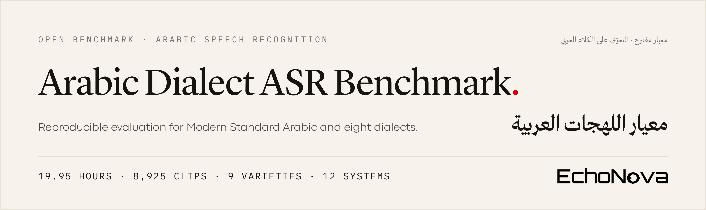
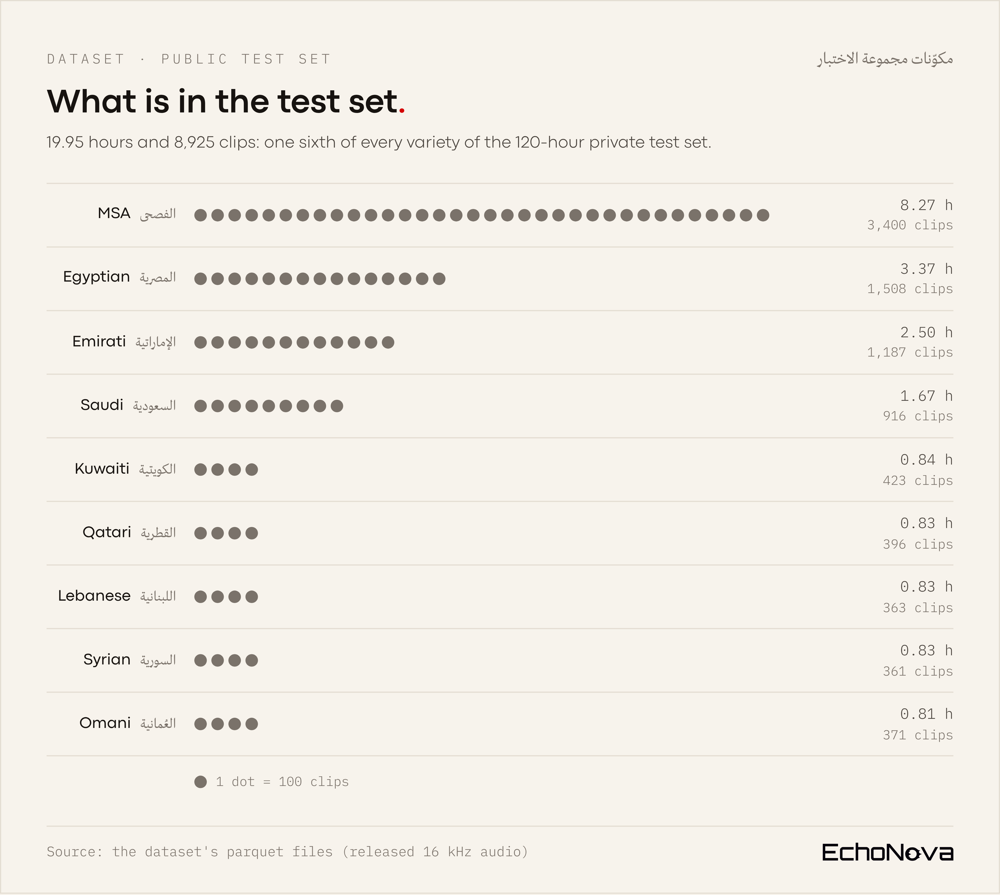
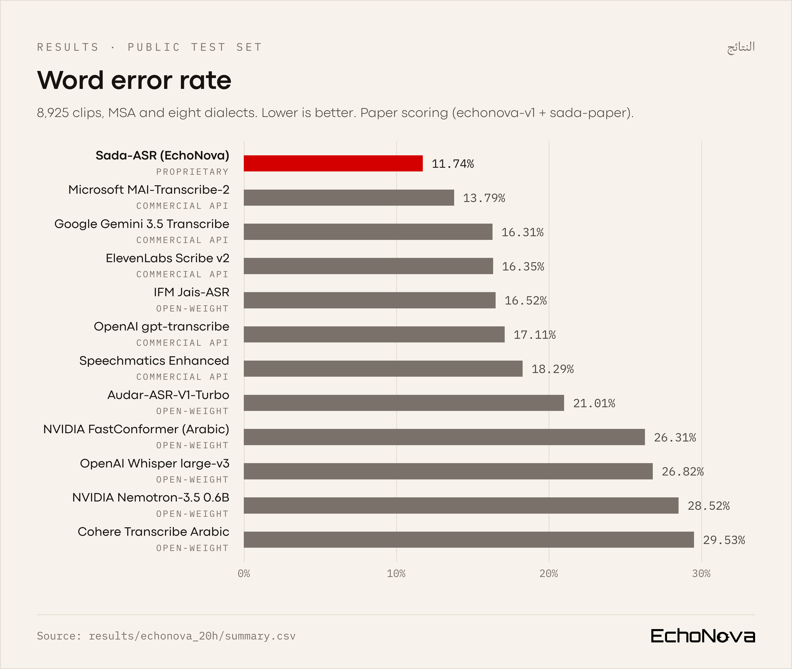
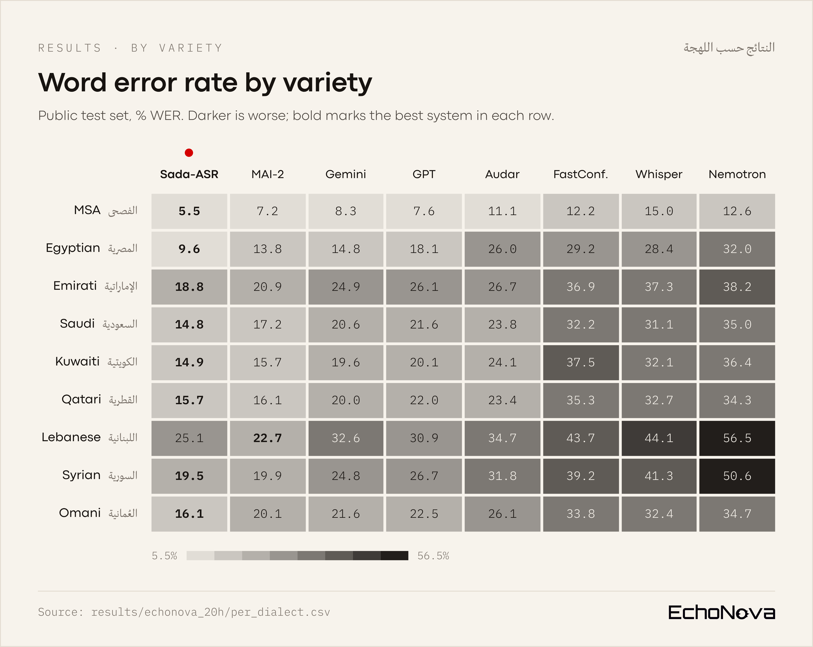

<div align="center">



<p>
  <a href="https://huggingface.co/datasets/echonova-ai/arabic-dialect-asr-benchmark"></a>
  <a href="https://echonova.ai/research/pdf/EchoNova_Sada-ASR_Technical_Report.pdf"></a>
  <a href="LICENSE"></a>
  
  <a href="https://github.com/echonova-ai-solutions/arabic-asr-benchmark/actions/workflows/ci.yml"></a>
</p>

<p>
  <b>📊 <a href="#-results">Results</a></b> &nbsp;·&nbsp;
  <b>⚡ <a href="#-quick-start">Quick start</a></b> &nbsp;·&nbsp;
  <b>🗂️ <a href="docs/dataset.md">Test set</a></b> &nbsp;·&nbsp;
  <b>🔤 <a href="docs/normalization.md">Normalization</a></b> &nbsp;·&nbsp;
  <b>🔁 <a href="docs/reproducibility.md">Reproduce</a></b> &nbsp;·&nbsp;
  <b>📄 <a href="#-citation">Cite</a></b>
</p>

<b>Reproducible evaluation of Arabic speech recognition across MSA and eight dialects.</b>

<p dir="rtl">
مجموعة اختبار مفتوحة لقياس دقة تحويل الكلام العربي إلى نص: الفصحى وثماني لهجات، في 19.95 ساعة و8,925 مقطعًا، ولكل مقطع نص مرجعي كتبه إنسان.
</p>

</div>

This repository holds the evaluation code, normalizers, scoring protocol, results
and per-clip system outputs behind EchoNova's Arabic speech recognition benchmark.
It accompanies the paper [*Sada-ASR: A Production Multidialectal Arabic Speech
Recognition System*](https://echonova.ai/research/pdf/EchoNova_Sada-ASR_Technical_Report.pdf) and the public test set
[`echonova-ai/arabic-dialect-asr-benchmark`](https://huggingface.co/datasets/echonova-ai/arabic-dialect-asr-benchmark).

The evaluation works with any system's transcripts: you need a predictions
file, not access to any model, API key or EchoNova service.

## 🔎 Overview

- **Public test set.** 19.95 hours (8,925 clips) of Modern Standard Arabic and
  Egyptian, Saudi, Emirati, Kuwaiti, Qatari, Omani, Syrian and Lebanese speech
  with verbatim transcripts: a one-sixth, duration-stratified sample of the
  120-hour private test set evaluated in the paper.
- **Twelve systems** measured on it: EchoNova's Sada-ASR, five commercial APIs
  and six open-weight models, the systems compared in the paper. The raw per-clip
  outputs of ten of them are published, so their figures can be recomputed;
  ElevenLabs Scribe v2 and Speechmatics Enhanced are reported as metrics only.
- **Versioned normalizers and scoring.** `echonova-v1` and the `sada-paper`
  scoring protocol reproduce the paper's scoring exactly; reproductions of the
  Open Universal Arabic ASR Leaderboard's normalizer are included too.
- **Paper results** on the full private test set and on six public test sets,
  recomputed from stored outputs and labelled by how far they can be verified.

<p align="center">

</p>

## 🔗 Resources

| Resource | Link |
| :--- | :--- |
| Test set (Hugging Face) | [echonova-ai/arabic-dialect-asr-benchmark](https://huggingface.co/datasets/echonova-ai/arabic-dialect-asr-benchmark) |
| Paper | [*Sada-ASR: A Production Multidialectal Arabic Speech Recognition System*](https://echonova.ai/research/pdf/EchoNova_Sada-ASR_Technical_Report.pdf) (Khaled, Abd-Elnaser and Mohsen, 2026), EchoNova technical report |
| Open Universal Arabic ASR Leaderboard | [Hugging Face Space](https://huggingface.co/spaces/elmresearchcenter/open_universal_arabic_asr_leaderboard) · [code](https://github.com/Natural-Language-Processing-Elm/open_universal_arabic_asr_leaderboard) |
| Methodology | [docs/methodology.md](docs/methodology.md) |
| Normalization and scoring | [docs/normalization.md](docs/normalization.md) |
| Test set construction and statistics | [docs/dataset.md](docs/dataset.md) |
| Reproducing the results | [docs/reproducibility.md](docs/reproducibility.md) |
| Paper consistency review | [docs/paper_consistency.md](docs/paper_consistency.md) |

## 📊 Results

### Public test set (19.95 h, 9 varieties)

WER, macro WER and CER in %, normalizer `echonova-v1` with the `sada-paper`
scoring protocol. WER and CER are corpus micro-averages; macro WER is the
unweighted mean of the nine per-variety WERs; Empty is the share of clips with an
empty transcript. Recomputed from each system's stored outputs. The outputs of
ten systems are published in [`results/echonova_20h/predictions/`](results/echonova_20h/predictions/),
so their figures are **fully verifiable at the metric level**; ElevenLabs Scribe v2
and Speechmatics Enhanced are metrics only.

<p align="center">

</p>

<!-- BEGIN echonova-20h-summary -->
| System | Type | WER | Macro WER | CER | Empty % |
| :--- | :--- | ---: | ---: | ---: | ---: |
| Sada-ASR (EchoNova) | proprietary | 11.74 | 15.56 | 4.72 | 0.00 |
| Microsoft MAI-Transcribe-2 | commercial API | 13.79 | 17.07 | 6.52 | 0.01 |
| Google Gemini 3.5 Transcribe | commercial API | 16.31 | 20.80 | 8.39 | 0.03 |
| ElevenLabs Scribe v2 | commercial API | 16.35 | 20.69 | 7.73 | 0.10 |
| IFM Jais-ASR | open-weight | 16.52 | 21.03 | 6.96 | 0.00 |
| OpenAI gpt-transcribe | commercial API | 17.11 | 21.72 | 8.61 | 0.01 |
| Speechmatics Enhanced | commercial API | 18.29 | 24.54 | 8.90 | 0.00 |
| Audar-ASR-V1-Turbo | open-weight | 21.01 | 25.29 | 10.09 | 0.00 |
| NVIDIA FastConformer (Arabic) | open-weight | 26.31 | 33.36 | 12.42 | 0.00 |
| OpenAI Whisper large-v3 | open-weight | 26.82 | 32.72 | 15.17 | 0.00 |
| NVIDIA Nemotron-3.5 ASR streaming 0.6B | open-weight | 28.52 | 36.71 | 11.65 | 0.06 |
| Cohere Transcribe Arabic | open-weight | 29.53 | 38.52 | 19.75 | 0.03 |
<!-- END echonova-20h-summary -->

WER (%) by variety (best per row in bold):

<p align="center">

</p>

<details>
<summary>The same values as a table</summary>

<!-- BEGIN echonova-20h-wer-by-dialect -->
| Dialect | Clips | Sada-ASR (EchoNova) | Microsoft MAI-Transcribe-2 | Google Gemini 3.5 Transcribe | ElevenLabs Scribe v2 | IFM Jais-ASR | OpenAI gpt-transcribe | Speechmatics Enhanced | Audar-ASR-V1-Turbo | NVIDIA FastConformer (Arabic) | OpenAI Whisper large-v3 | NVIDIA Nemotron-3.5 ASR streaming 0.6B | Cohere Transcribe Arabic |
| :--- | ---: | ---: | ---: | ---: | ---: | ---: | ---: | ---: | ---: | ---: | ---: | ---: | ---: |
| msa | 3400 | **5.54** | 7.18 | 8.27 | 8.09 | 7.92 | 7.62 | 8.01 | 11.11 | 12.21 | 14.98 | 12.64 | 15.59 |
| egyptian | 1508 | **9.60** | 13.81 | 14.85 | 15.71 | 16.61 | 18.08 | 17.66 | 25.99 | 29.25 | 28.37 | 32.04 | 25.84 |
| saudi | 916 | **14.76** | 17.17 | 20.61 | 21.60 | 20.91 | 21.56 | 21.64 | 23.80 | 32.18 | 31.13 | 35.04 | 31.19 |
| emirati | 1187 | **18.83** | 20.89 | 24.88 | 24.55 | 24.34 | 26.05 | 26.67 | 26.65 | 36.94 | 37.32 | 38.19 | 45.08 |
| kuwaiti | 423 | **14.94** | 15.70 | 19.63 | 18.97 | 20.66 | 20.12 | 35.38 | 24.05 | 37.54 | 32.12 | 36.44 | 42.86 |
| qatari | 396 | **15.71** | 16.15 | 19.95 | 21.01 | 20.15 | 21.97 | 21.96 | 23.40 | 35.30 | 32.72 | 34.33 | 44.59 |
| omani | 371 | **16.06** | 20.05 | 21.60 | 22.28 | 21.50 | 22.52 | 21.80 | 26.10 | 33.84 | 32.41 | 34.69 | 39.82 |
| syrian | 361 | **19.48** | 19.92 | 24.81 | 24.34 | 26.46 | 26.68 | 32.85 | 31.77 | 39.20 | 41.31 | 50.59 | 43.00 |
| lebanese | 363 | 25.07 | **22.74** | 32.63 | 29.66 | 30.76 | 30.88 | 34.90 | 34.75 | 43.74 | 44.13 | 56.48 | 58.70 |
<!-- END echonova-20h-wer-by-dialect -->

</details>

The Kuwaiti, Qatari, Omani, Syrian and Lebanese slices hold under an hour each,
so their figures carry wide confidence intervals; see
[`results/echonova_20h/bootstrap.csv`](results/echonova_20h/bootstrap.csv)
(paired, recording-level bootstrap). Results under other normalizers, per-variety
CER and all six folds are in [`results/echonova_20h/`](results/echonova_20h/).

### Private test set (paper, 119.86 h, 9 varieties)

The figures reported in the paper (Table 2), recomputed with this package from
the stored outputs on the full private test set of 53,597 clips. **Reported, not
externally reproducible:** the audio and references beyond the public sixth are
not released.

<!-- BEGIN echonova-120h-summary -->
| System | Type | WER | Macro WER | CER | Empty % |
| :--- | :--- | ---: | ---: | ---: | ---: |
| Sada-ASR (EchoNova) | proprietary | 11.69 | 15.52 | 4.76 | 0.00 |
| Microsoft MAI-Transcribe-2 | commercial API | 13.51 | 16.96 | 6.37 | 0.00 |
| ElevenLabs Scribe v2 | commercial API | 16.12 | 20.67 | 7.54 | 0.08 |
| Google Gemini 3.5 Transcribe | commercial API | 16.13 | 20.84 | 8.23 | 0.02 |
| IFM Jais-ASR | open-weight | 16.41 | 21.00 | 6.89 | 0.00 |
| OpenAI gpt-transcribe | commercial API | 17.03 | 21.69 | 8.59 | 0.01 |
| Speechmatics Enhanced | commercial API | 18.08 | 24.37 | 8.73 | 0.00 |
| Audar-ASR-V1-Turbo | open-weight | 20.86 | 25.17 | 9.97 | 0.00 |
| NVIDIA FastConformer (Arabic) | open-weight | 25.97 | 32.93 | 12.31 | 0.01 |
| OpenAI Whisper large-v3 | open-weight | 26.57 | 32.56 | 15.08 | 0.00 |
| NVIDIA Nemotron-3.5 ASR streaming 0.6B | open-weight | 28.11 | 36.35 | 11.43 | 0.10 |
| Cohere Transcribe Arabic | open-weight | 29.11 | 37.94 | 19.41 | 0.05 |
<!-- END echonova-120h-summary -->

### Open Universal Arabic ASR Leaderboard test sets

Sada-ASR's WER (%) on the six test sets of the
[Open Universal Arabic ASR Leaderboard](https://huggingface.co/spaces/elmresearchcenter/open_universal_arabic_asr_leaderboard)
(Wang et al., 2025). **EchoNova-reproduced:** run by EchoNova and scored with the
leaderboard's evaluation code; not an official leaderboard entry. Avg is the
unweighted mean of the six sets, as on the leaderboard.

<!-- BEGIN public-leaderboard -->
| System | SADA | CV 18.0 | MASC-c | MASC-n | Casab. | MGB-2 | Avg |
| :--- | ---: | ---: | ---: | ---: | ---: | ---: | ---: |
| Sada-ASR, leaderboard's current code (`oual-2026-07`) | 25.76 | 3.95 | 5.35 | 16.70 | 41.72 | 9.56 | 17.17 |
<!-- END public-leaderboard -->

The leaderboard changed its evaluation code on 27 July 2026 and did not re-score
the rows already on it, so comparisons with published figures are indicative.
Published figures for other systems, the protocol details and caveats are in
[`results/public_leaderboard/`](results/public_leaderboard/).

## 📦 Installation

```bash
pip install "arabic-asr-benchmark[hf] @ git+https://github.com/echonova-ai-solutions/arabic-asr-benchmark"
```

Python 3.10 or newer. The core package depends only on `numpy` and
`editdistance`; the `hf` extra adds `datasets` for loading the test set.

## ⚡ Quick start

1. Transcribe every clip of the test set with your system:

   ```python
   from datasets import load_dataset

   ds = load_dataset("echonova-ai/arabic-dialect-asr-benchmark", split="test")
   # ds[i]["audio"]["array"] is 16 kHz mono; decoding with datasets 4.x or later
   # needs pip install "datasets[audio]"
   ```

2. Write one JSON object per clip to `predictions.jsonl`, with your system's raw
   output (the scorer normalizes):

   ```json
   {"id": "egyptian_00001", "prediction": "..."}
   ```

3. Score:

   ```bash
   asr-bench evaluate --predictions predictions.jsonl --system my-system --output my-system.json
   ```

   This prints overall WER, macro WER and CER, writes per-dialect results, and
   uses the paper's scoring (`echonova-v1`, `sada-paper`). Missing, duplicate or
   unknown ids are errors.

4. Compare with a published system, with a paired bootstrap CI:

   ```bash
   asr-bench compare --predictions mine=predictions.jsonl \
       sada-asr=results/echonova_20h/predictions/sada-asr.jsonl \
       --baseline mine --order msa,egyptian,saudi,emirati,kuwaiti,qatari,syrian,lebanese,omani
   ```

Try it without downloading anything, on the bundled synthetic example:

```bash
asr-bench evaluate --references examples/synthetic/references.jsonl \
    --predictions examples/synthetic/predictions_system_a.jsonl
```

To get Sada-ASR's transcripts yourself, use the EchoNova speech-to-text API:
[`scripts/transcribe_with_sada_api.py`](scripts/transcribe_with_sada_api.py)
transcribes the test set through it and writes a predictions file to score as
above (see [docs/reproducibility.md](docs/reproducibility.md#5-run-sada-asr-yourself)).

## 📐 Evaluation methodology

- **Normalization.** References and hypotheses are normalized identically
  before scoring. `echonova-v1` (default) is the paper's normalizer: it removes
  ASCII and Arabic punctuation and the harakat, folds the hamza and madda forms of
  alif, hamza on waw and ya, پ and ڤ, Eastern Arabic digits and ة→ه, and deletes
  standalone hamza. It does not fold ى and does not convert numbers between digits
  and words.
- **Scoring protocol.** With `echonova-v1`, the `sada-paper` protocol is applied
  to every system: any one- to three-word unit repeated more than ten times in a
  row in a hypothesis is cut to ten copies, and whitespace is canonicalized on
  both sides. See [docs/normalization.md](docs/normalization.md).
- **Metrics.** WER and CER are corpus-level: total edit distance over total
  reference length (never a mean of per-clip rates). Macro WER averages the
  per-variety WERs without weighting. Empty transcripts count as full deletions.
- **Confidence intervals.** Paired bootstrap over recordings (default) or clips,
  2,000 resamples, seed 0.

Details: [docs/methodology.md](docs/methodology.md).

## 🔁 Reproducibility

| What | Who can verify it |
| :--- | :--- |
| Metric computation for the ten systems with published outputs | Anyone: references and per-clip outputs are public |
| Metrics of ElevenLabs Scribe v2 and Speechmatics Enhanced | Not externally: their per-clip outputs are not published |
| Inference of the open-weight models | Anyone with the models (settings and dates in [`systems.json`](results/echonova_20h/systems.json)) |
| Inference of the commercial APIs | Only approximately: hosted models change without notice; measurements are dated |
| Inference of Sada-ASR | Through the EchoNova speech-to-text API ([`scripts/transcribe_with_sada_api.py`](scripts/transcribe_with_sada_api.py)); the published figures come from the evaluated version on EchoNova's hardware, so API results can differ |
| Results on the unreleased five sixths | Not externally: recomputed by EchoNova from stored outputs |

Step-by-step commands: [docs/reproducibility.md](docs/reproducibility.md).

## 📄 Citation

If you use the test set or this code, please cite the paper:

```bibtex
@misc{khaled2026sadaasr,
  title  = {Sada-ASR: A Production Multidialectal Arabic Speech Recognition System},
  author = {Khaled, Mahmoud and Abd-Elnaser, Mohammed and Mohsen, Mahmoud},
  year   = {2026},
  note   = {EchoNova technical report},
  howpublished = {\url{https://echonova.ai/research/pdf/EchoNova_Sada-ASR_Technical_Report.pdf}}
}
```

and the benchmark:

```bibtex
@misc{mohsen2026echonova,
  title        = {EchoNova Arabic Dialect ASR Benchmark},
  author       = {Mohsen, Mahmoud},
  year         = {2026},
  howpublished = {\url{https://huggingface.co/datasets/echonova-ai/arabic-dialect-asr-benchmark}},
  note         = {EchoNova. Code and results: \url{https://github.com/echonova-ai-solutions/arabic-asr-benchmark}}
}
```

See also [CITATION.cff](CITATION.cff).

## ⚖️ License

Code: Apache License 2.0 (see [LICENSE](LICENSE)). The test set has its own
license, stated on its Hugging Face page. Published system outputs are provided
for verifying the reported metrics.

## 🙏 Acknowledgments

We thank the maintainers of the Open Universal Arabic ASR Leaderboard
(Wang, Alhmoud and Alqurishi, 2025) and the creators of the SADA, Common Voice,
MASC, MGB-2 and Casablanca test sets. The leaderboard normalizers here are
independent re-implementations of its published evaluation code.
